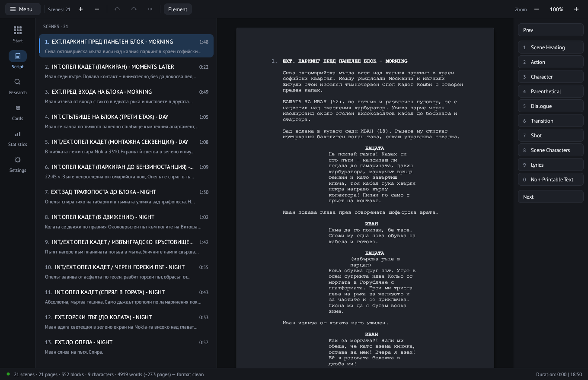
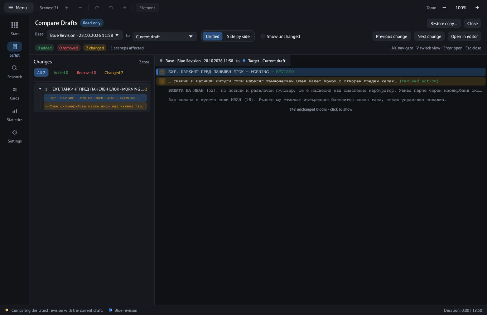

<div align="center">

  

  # ScriptCraft

  **The free, open-source, revision-first screenwriting studio.**

  [](https://github.com/MihailM17/scriptcraft/releases)
  [](https://github.com/MihailM17/scriptcraft/actions/workflows/ci.yml)
  [](https://www.rust-lang.org)
  [](LICENSE)
  [](#installation)

  <p align="center">
    <a href="#key-features">Key Features</a> •
    <a href="#why-revision-first">Why Revision-First</a> •
    <a href="#interchange-support">Interchange</a> •
    <a href="#installation">Downloads</a> •
    <a href="#performance-budgets">Benchmarks</a> •
    <a href="#build-from-source">Build</a> •
    <a href="#contributing">Contributing</a>
  </p>

</div>

---

ScriptCraft is a native, offline-first screenwriting application built in Rust for writers and production teams. 

Most screenwriting software treats the production phase as an afterthought or a paywalled extra. ScriptCraft is engineered from the ground up around **production revisions**: open KIT Scenarist projects, exchange Final Draft and Fade In files, lock pages and scene numbers, issue colored revision sets, and export page-exact PDFs—blazing fast, fully offline, on macOS, Windows, and Linux.

<div align="center">
  
  <p><em>The ScriptCraft Editor: Typographically exact 1/6-inch line pitch, live revision marks, and distraction-free writing.</em></p>
</div>

<details>
<summary><b>🚀 What's New in v0.8.15 (Click to expand)</b></summary>
<br>

* **Full Studio UI Redesign:** Polished every native `egui` view—Start, Script toolbar & quiet Elements rail, responsive Corkboard cards, Statistics KPI strip, Export dialog, compact Menu popup, Research module, Compare Drafts header, Revisions Hub, Revision Summary, and About/Help windows.
* **Inline Bold, Italic & Underline:** Apply inline formatting (`⌘B` / `⌘I` / `⌘U`, `Ctrl+B/I/U`, or the Script toolbar `B` / `I` / `U` pills) on selections or the word under the caret—painted on the exact monospace grid, exported to PDF with bundled italics, and round-tripped through `.kitsp`, `.fdx`, `.fadein`, and `.fountain`.
* **Opt-In US Letter Support:** A4 (`58` lines/page) remains the default; switch to standard Hollywood US Letter (`8.5 × 11 in`, `55` lines/page) in **Settings → Appearance → Page size** or override per export in **Export Scenario → Template**.
* **Revisions Hub & Wrapped Compare Diffs:** Redesigned `Research ▸ Versions` with an inline timeline, wrapped multi-line Compare diffs in Unified and Side-by-Side modes, and clickable Revision Summary rows that jump directly to the scene.
* **Upgraded Find & Replace & macOS File Associations:** Added Match Case (`Aa`), Whole Word (`W`), and empty-string deletion to Find & Replace, plus macOS Finder `.kitsp` / `.fdx` / `.fadein` / `.fountain` double-click open support.
* **Highlighted Button Contrast & Native macOS Dock Icon (v0.8.14):** Re-calibrated `accent_soft` premultiplied alpha across all six writer themes, added dynamic `ink_on_accent` contrast ink, and restored native `ScriptCraft.icns` rendering in the macOS Dock.
* **35 Contrast-Tested Themes & Bundled Fonts:** Includes six writer themes (*Midnight Ink*, *Amber Projector*, *Noir Emerald*, *Velvet Curtain*, *Red Light*, *Paper and Rust*) and bundled Liberation Mono, IBM Plex Mono, and Courier Prime.
* **Lossless Interchange:** Import and export `.kitsp`, `.fdx`, `.fadein`, `.fountain`, plus Markdown export.
* **In-Place Updates & Crash Resilience:** SHA-256 verified auto-updates with post-exit restart and integrated `panic.log` diagnostics.

*See the full release history in [`docs/releases/`](docs/releases/).*

</details>

---

## 🎬 Why Revision-First?

A screenplay is not finished when the first draft is written. It is finished when **pages are locked, scenes are numbered, revisions are issued, and the entire cast and crew are working from the exact same colored pages**.

ScriptCraft treats the production workflow as the core product:

* 🎨 **Industry Revision Sets:** Blue → Pink → Yellow → Green → Goldenrod → Buff → Salmon → Cherry with timestamps, names, and page-count baselines saved inside the project.
* 🔒 **Locked Pages & Scenes:** Freeze issued pagination. Adding text after a lock generates `42A`, `42B` sub-pages; subsequent pages maintain their original numbers. Scene numbers lock independently.
* 📑 **Visible Change Marks:** Colored margin bars and asterisk (`*`) marks indicate modified blocks. Filter the view to display only current-revision pages.
* ⚖️ **Draft Comparison & Diffs:** Compare any two drafts or compare a live draft against a revision baseline. Jump directly to differences with clickable gaps.
* 📊 **Revision Summary:** Scene-grouped counts for added, removed, and modified blocks, deterministic UTF-8 CSV exports for production spreadsheets, and printable A4 summary PDFs.
* 🔄 **Restore-as-Copy:** Safely restore any past revision baseline as a fresh project without overwriting current work.

<div align="center">
  
  <p><em>Compare a revision baseline against the active draft: filter deltas, inspect changes, and jump directly to blocks that need attention.</em></p>
</div>

---

## ✨ Key Features

### 📐 Mathematically Exact Layout & Pagination
* **Fixed 1/6-Inch Line Leading:** Adheres strictly to the 12 pt screenplay grid (4.2333 mm pitch, 58 lines per A4 page) matching KIT Scenarist and Final Draft.
* **Zoom-Independent Engine:** Geometry is calculated in document units (millimetres and rows). Zooming scales rendering without ever reflowing text or shifting page breaks.
* **Typeface Fidelity:** Prefers system Courier New, falling back gracefully to bundled Liberation Mono, Courier Prime, or IBM Plex Mono with exact 0.6 em advance across Latin and Cyrillic.

### ✍️ Distraction-Free Screenplay Editor
* **Smart Screenplay Formatting:** Auto-advancing block types, autocomplete for scenes, characters, and locations, plus FastFormat hotkeys (`Cmd+1`–`Cmd+0` / `Ctrl+1`–`Ctrl+0`).
* **Intelligent Paste:** Split pasted text from ChatGPT or raw documents into proper scene headings, action, cues, parentheticals, and dialogue blocks.
* **Native Dual Dialogue:** Side-by-side simultaneous dialogue with full pagination and PDF export support.
* **Writing-Aware Spellchecker:** Built-in Hunspell spellchecking for English (US), Bulgarian, and Russian. Intelligently ignores ALL-CAPS sluglines and character cues to avoid false flags.

### 🎨 35 Contrast-Checked Themes
* **ScriptCraft Originals:** Midnight, Light, Sepia, High Contrast, KIT Scenarist Light & Dark, and Writer Palettes (Midnight Ink, Amber Projector, Noir Emerald, Velvet Curtain, Red Light, Paper and Rust).
* **Curated Studio Themes:** Tokyo Night, Catppuccin, Nord, Gruvbox, Rosé Pine, Everforest, Kanagawa, Dracula, and more.
* **Monochrome Paper Mode:** Render white paper with dark ink while keeping your editor chrome dark.

### 🗂️ Studio Tools: Cards, Research & Stats
* **Index Cards:** Visual corkboard for organizing scenes, structure, and beats.
* **Research Workspace:** Automatic entity recognition for characters and locations with rich reference cards and photo attachments.
* **Chronometry & Statistics:** Real-time story duration estimates calibrated to scene word-counts, dialogue-to-action ratios, and character speaking time reports.

---

## 🔄 Interchange Support

ScriptCraft prioritizes open ecosystems and guarantees honest interchange with industry-standard software:

| Format | Extension | Import | Export | Revision Tracking | Fidelity Notes |
|:---|:---:|:---:|:---:|:---:|:---|
| **KIT Scenarist** | `.kitsp` | ✅ | ✅ | ✅ | Clean-room SQLite round-tripping; unknown sidecar rows preserved |
| **Final Draft** | `.fdx` | ✅ | ✅ | ✅ | Revision colors, asterisk `*` marks, dual dialogue, title page |
| **Fade In** | `.fadein` | ✅ | ✅ | ✅ | ZIP + OSF archive with scene numbers, notes, and dual dialogue |
| **Fountain** | `.fountain` | ✅ | ✅ | — | Industry-standard plain text formatting |
| **Print-Ready PDF** | `.pdf` | — | ✅ | ✅ | Generated directly from the layout engine; 1:1 parity with editor view |
| **Markdown** | `.md` | — | ✅ | — | Clean structured text export for wikis, notes, and collaboration |

---

## ⚡ Performance Budgets

ScriptCraft is written in 100% native Rust—no web views, no Electron overhead, and zero runtime bloat. Every critical path is covered by Criterion benchmarks ([`docs/benchmarks.md`](docs/benchmarks.md)):

| Benchmark Metric | Measurement | Performance Target |
|:---|:---|:---|
| **Incremental Block Relayout** | `92 µs` | Must stay < 16 ms (60 FPS typing budget) |
| **Draft Diff & Compare** | `44 µs` | Instant real-time comparison |
| **Revision Marks Resolution** | `3.1 µs` | Zero overhead on editor draw |
| **SQLite `.kitsp` Load** | `0.66 ms` | Sub-millisecond project opens |
| **Full A4 Layout (21 Scenes)** | `0.76 ms` | Instant initial pagination |
| **Full PDF Export** | `30 ms` | Near-instant disk export |

---

## 📦 Installation

Prebuilt binaries are available for every major desktop operating system on the [**Releases Page**](https://github.com/MihailM17/scriptcraft/releases):

| Platform | Architecture | Package Format | Notes |
|:---|:---|:---|:---|
| **macOS** | Apple Silicon (`arm64`) | `ScriptCraft-<version>-macos-arm64.dmg` | Ad-hoc signed. *Right-click ▸ Open on first launch*. |
| **Windows** | x64 (Windows 10/11) | `ScriptCraft-<version>-windows-x64.zip` | Unzip and run `ScriptCraft.exe`. Dark DWM titlebar enabled. |
| **Linux** | x86_64 | `ScriptCraft-<version>-linux-x86_64.tar.gz` | Requires GTK3 (`libgtk-3-0`). Includes desktop file and icon. |

> [!NOTE]
> **Code Signing:** macOS builds are currently ad-hoc signed and Windows/Linux archives are unsigned. An in-place SHA-256 verified updater is included in-app. Developer ID notarization is in progress.

---

## 🛠️ Build from Source

### Prerequisites
* Rust 1.80+ (`rustup default stable`)
* GTK3 development headers on Linux (`sudo apt install libgtk-3-dev`)

### Run in Development
```sh
cargo run -p scriptcraft-app
```

### Build Optimized Release Binary
```sh
cargo build --release -p scriptcraft-app
```
The compiled binary will be located at `target/release/scriptcraft-app`.

### Testing & Verification
ScriptCraft maintains strict test coverage, visual snapshots, and supply-chain checks:

```sh
# Run the full unit and integration test suite
cargo test --workspace

# Linting and formatting checks
cargo fmt --check
cargo clippy --workspace --all-targets -- -D warnings
cargo deny check

# Run off-screen visual UI snapshot regression tests
UPDATE_SNAPSHOTS=1 cargo test -p scriptcraft-app --test ui_snapshots
```

---

## 🏗️ Architecture

The repository is organized into three decoupled crates:

```
scriptcraft/
├── scriptcraft-core/     # Pure document models, SQLite (.kitsp), FDX, Fade In, 
│                         # revision diffing, validation, and chronometry.
├── scriptcraft-layout/   # Document-unit layout engine (wrapping, 58-line pagination,
│                         # millimeter coordinate placement, and printpdf export).
└── scriptcraft-app/      # Native egui/eframe desktop application, UI widgets,
                          # 35 themes, spellchecker, and OS integrations.
```

* Migrating from KIT Scenarist? Check out the [KIT Scenarist Migration Guide](docs/migration-from-kit.md).
* Interested in project internals? Read [KIT Format Specifications](docs/kitsp-format.md) and the [v0.8 Architecture Plan](docs/v0.8-plan.md).

---

## 🤝 Contributing

Contributions from the filmmaking and open-source communities are warmly welcome! Please review [`CONTRIBUTING.md`](CONTRIBUTING.md) before submitting a pull request.

The highest-value contributions right now:
* 📁 **Real-world fixtures:** Permission-cleared `.fdx`, `.kitsp`, `.fadein`, or Fountain scripts to test edge-case wrapping and pagination.
* 🪟 **Platform testing:** Testing on various Linux desktop environments (Wayland/X11) and Windows 10/11 scaling configurations.
* 🌐 **Internationalization:** Bulgarian, Cyrillic, and non-Latin screenplay convention validation.
* 🐛 **Bug reports:** Detailed reproduction steps with minimal reproduction files.

---

## 📄 License

ScriptCraft is licensed under the [Apache License, Version 2.0](LICENSE).  
Bundled typefaces (Courier Prime, IBM Plex Mono, Liberation Mono, PT Sans) are distributed under the [SIL Open Font License](http://scripts.sil.org/OFL). See `NOTICE` and [`scriptcraft-app/assets/fonts/licenses/`](scriptcraft-app/assets/fonts/licenses/) for details.
