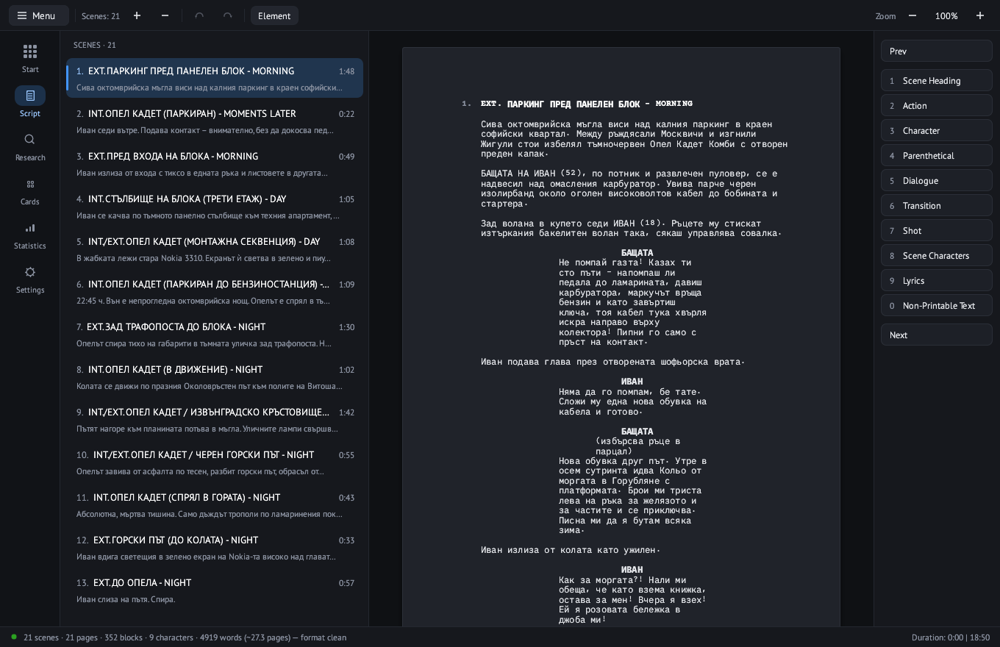

# ScriptCraft

**The free, open-source, revision-first screenwriting studio.**

ScriptCraft is a native Rust screenwriting app for writers and production teams.
It is built around the part of the job most tools treat as an add-on:
production revisions. Open KIT projects, exchange Final Draft files, lock
pages, issue coloured revisions, and export page-exact PDFs — offline, on
macOS, Windows and Linux.

> **Status — v0.7 revision workflow.** The current tree implements revision
> sets, coloured margin marks, revision pages, page locks, `42A`/`42B`
> numbering, KIT saved-version import, and revision metadata in PDF and FDX.
>
> **Next — v0.8 revision-complete.** Draft comparison and restore, omitted
> scenes, dual dialogue, a title-page editor, and a revision summary.



## Why revision-first

A screenplay is not finished when the draft is. It is finished when pages are
locked, scenes are numbered, revisions are issued, and everyone is working from
the same coloured pages. ScriptCraft treats that as the core workflow, not a
plugin or a paid upgrade.

The goal is simple: **no compromises on the work a production actually
depends on** — correct pagination, reliable revisions, honest interchange, and
never losing a word. It is not a promise to clone every feature of every paid
app on day one.

## The revision workflow

- **Revision sets** — Blue → Pink → Yellow → … with names, dates and page-count
  baselines. Baselines live inside the `.kitsp` project and survive reopen; the
  Revision History window lists every set.
- **Visible marks** — changed blocks get coloured margin bars; revision-pages
  mode shows only the current revision.
- **Page-exact output** — revision colours, `*` marks, header/footer revision
  labels and Revised title-page fields in PDF and Final Draft `.fdx`.
- **Locked pages and scenes** — freeze issued pagination. Pages inserted after
  a lock are labelled `42A`, `42B`, …; later pages keep their original numbers.
  Scene numbers have a separate lock.
- **KIT version import** — every recoverable saved version in a `.kitsp`
  project can become a revision baseline.
- **Next (v0.8)** — compare any two drafts, restore a baseline as a copy, omit
  scenes, dual dialogue, a title-page editor, and a revision summary.

## The editor

- Fixed A4 page editor with Courier Prime, page-accurate pagination, scene
  numbers, `(MORE)` / `(CONT'D)` markers, and zoom that scales pages without
  reflowing text.
- Autocomplete for scene headings, characters, locations and transitions.
- Undo/redo, find/replace, typewriter scrolling, multi-document support,
  autosave, and crash recovery from atomic saves.
- Script, Research, Cards, Statistics and Settings modules, plus a Start page
  with recent projects and a one-click Open Projects Folder button.
- Light and Midnight themes, picked in Settings ▸ Theme, with the ScriptCraft
  icon-blue accent.
- FastFormat shortcuts: select one or more blocks and press `Cmd+1`…`Cmd+0`
  (`Ctrl+1`…`Ctrl+0` on Windows/Linux) for scene heading, action, character,
  parenthetical, dialogue, transition, shot, scene characters, lyrics and
  non-printable text.
- Native macOS menu bar plus the KIT-style in-app menu (Windows and Linux use
  the in-app menu).
- IME input, cross-block selection, and command-based undo/redo through the
  shared document model.

## Interchange

- **KIT `.kitsp`** — read and write real KIT Scenarist projects, including
  metadata, research, cards and saved versions. ScriptCraft-only data
  (revision baselines, page locks) lives in `scenario_data` rows that KIT
  ignores.
- **Final Draft `.fdx`** — import/export paragraphs, title page, scene numbers,
  revision colours and `*` marks, and revised title-page fields.
- **Fountain** — import/export.
- **PDF** — rendered from the same layout engine as the editor, not a second
  paginator.
- **Planned** — conversion reports for lossy imports/exports, and DOCX/RTF only
  if real users need them.

## What this is — and what it isn't yet

ScriptCraft is:

- **Free and open source** (Apache-2.0), with no paywalled writing features.
- **Local-first**: no account, no telemetry by default, no cloud dependency.
- **Native**: one Rust layout engine behind the editor and the PDF renderer,
  not a web wrapper.
- **Interoperable**: KIT `.kitsp`, Final Draft `.fdx`, Fountain and PDF.
- **Revision-first**: the production workflow is the product, not an add-on.
- **Cross-platform**: macOS, Windows and Linux from one codebase.

It is not yet:

- a feature-for-feature Final Draft clone;
- a collaboration, cloud or account product;
- a production breakdown/tagging tool;
- a DOCX/RTF converter or a spellchecker;
- a plugin platform;
- fully signed and notarised on every platform. macOS builds are ad-hoc signed
  for now; Windows and Linux packages are new and still need wider runtime
  testing.

The scope is deliberate. If a feature is not needed for the revision workflow
or the writing core, it is not in v0.7.

## Install

Prebuilt packages are attached to each GitHub release:

- **macOS (Apple silicon):** `ScriptCraft-<version>-macos-arm64.dmg`, ad-hoc
  signed — right-click ▸ Open on first launch.
- **Windows 10/11 (x64):** `ScriptCraft-<version>-windows-x64.zip` — unzip and
  run `ScriptCraft.exe`.
- **Linux (x86_64):** `ScriptCraft-<version>-linux-x86_64.tar.gz` — needs GTK3
  (`sudo apt install libgtk-3-0` on Debian/Ubuntu); extract and run
  `./scriptcraft`. The archive also contains a `.desktop` file and icon.

## Build from source

```sh
cargo run -p scriptcraft-app
```

To build the optimised binary:

```sh
cargo build --release -p scriptcraft-app
```

Windows and Linux packages are built by `.github/workflows/packages.yml`;
the macOS `.app`/DMG is built locally (ad-hoc signed until notarisation lands
in v0.8).

## Tests

```sh
cargo test --workspace
cargo fmt --check
cargo clippy --workspace --all-targets -- -D warnings
cargo deny check
```

Snapshot tests:

```sh
UPDATE_SNAPSHOTS=1 cargo test -p scriptcraft-app --test ui_snapshots
```

The test suite includes A95 KIT round-trips, editor/PDF layout parity, FDX and
Fountain conversion, 500-page performance gates, interaction tests and UI
snapshots. See [`docs/v0.7-plan.md`](docs/v0.7-plan.md) for the acceptance
matrix.

## Project layout

- `scriptcraft-core/` — UI-free model, `.kitsp` reader/writer, Fountain and FDX
  converters, revision baselines, format validation and coaching checks.
- `scriptcraft-layout/` — the shared wrap/pagination/placement engine that
  drives both the editor pages and the PDF renderer.
- `scriptcraft-app/` — `eframe`/`egui` desktop app, theme, native menu and
  modules.
- `fixtures/A95.kitsp` — 21-scene Bulgarian test project used by the tests;
  `fixtures/example.fdx` — small Final Draft sample for the FDX tests.
- `docs/` — KIT format notes and the v0.7 revision-workflow plan.

## Contributing

Issues and pull requests are welcome. Read the current plan in
[`docs/v0.7-plan.md`](docs/v0.7-plan.md).

The highest-value contributions right now are:

- real-world, legally usable `.fdx`, `.kitsp` and Fountain fixtures (with
  provenance and permission);
- runtime testing on Windows and Linux;
- Bulgarian/Cyrillic text and screenplay-convention testing;
- bug reports with exact steps and a minimal project file.

## License

Apache-2.0. Bundled fonts are under the SIL Open Font License; see
`scriptcraft-app/assets/fonts/licenses/` and `NOTICE`.
